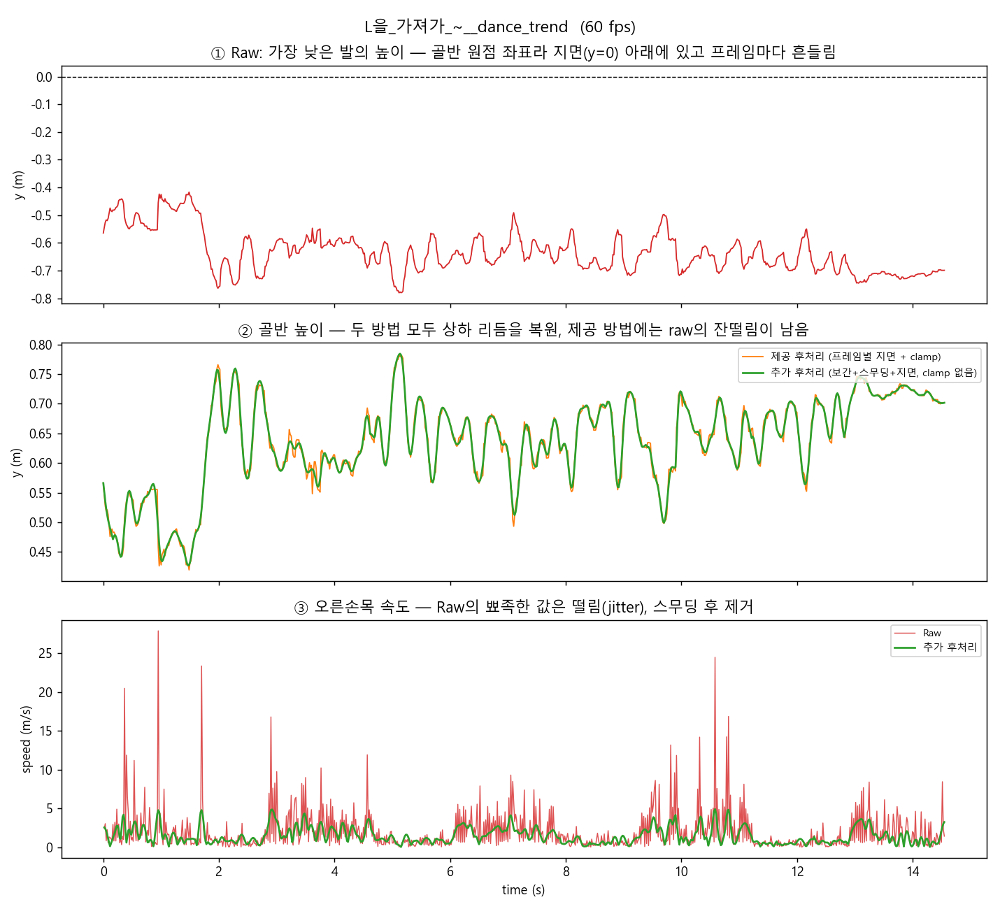
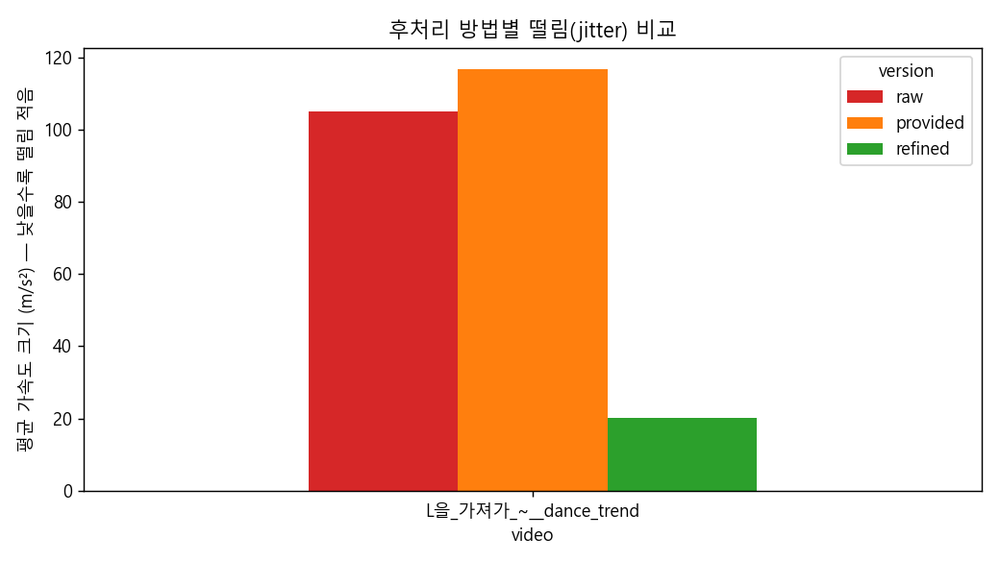

# 영상 기반 3D 모션 데이터 추출 및 후처리

유튜브 댄스 영상에서 MediaPipe BlazePose로 3D 관절 데이터를 뽑고, 데이터의 문제를 찾고, 후처리 전후를 비교했습니다.
과제에서 제공한 후처리 외에 **떨림 제거(스무딩)와 지면 보정 개선**을 추가로 구현했고, 결과는 Python(viser)과 Unity에서 시각화했습니다.

- **분석 영상:** [L을 가져가 ~ | dance trend](https://youtube.com/shorts/FQKf-ge5eZU) (60fps, 874프레임, 약 14.6초)
- **사용 모델:** MediaPipe BlazePose (`pose_world_landmarks`, 관절 33개, 단위 m)

---

## 과제 항목별 결과물

| 과제 항목 | 결과물 |
|---|---|
| 1. Data Acquisition | [`scripts/p1_create_raw_keypoints.py`](scripts/p1_create_raw_keypoints.py) → `data/raw_keypoints/*.npz` |
| 2. Problem Identification | [`scripts/p1_3_compare_and_refine.py`](scripts/p1_3_compare_and_refine.py) → 그래프 ①, `results/metrics.csv` |
| 3. Post-processing (제공 방법) | [`scripts/p1_2_post_processing.py`](scripts/p1_2_post_processing.py) → `data/processed/*_target.*` |
| 4. Results & Analysis | `p1_3_compare_and_refine.py` → 그래프 ②③, 지표 표 |
| Bonus: 추가 후처리 | `p1_3_compare_and_refine.py` → `data/processed/*_refined.*` |
| Bonus: 시각화 개선 | viser 3D 비교 재생 (`--vis`), Unity 재생 (`*_refined.csv`) |

---

## 실행 방법

### 환경 설치

```bash
conda env create -f environment.yml
conda activate ai_ml_final
```

테스트 환경: Python 3.10, mediapipe 0.10.21, opencv 4.11, numpy 1.26, scipy 1.15, matplotlib 3.10, viser 1.1.1

### 순서

```bash
# 1) 영상 다운로드 + 3D 관절 추출 (url_list에 유튜브 링크 입력)
python scripts/p1_create_raw_keypoints.py

# 2) 제공된 후처리 적용 + Unity CSV 생성 (브라우저 3D 재생: 터미널에 표시되는 주소, 기본 localhost:8080)
python scripts/p1_2_post_processing.py

# 3) 문제 분석 + 추가 후처리 + 전후 비교 (results/ 에 그래프·지표 저장)
python scripts/p1_3_compare_and_refine.py
python scripts/p1_3_compare_and_refine.py --vis         # 제공 후처리(왼쪽) vs 추가 후처리(오른쪽) 3D 재생
python scripts/p1_3_compare_and_refine.py --cutoff 8    # 스무딩 강도 변경 (기본 6Hz)
```

저장소에는 분석에 사용한 댄스 영상의 키포인트(`data/raw_keypoints/`)와 처리 결과(`data/processed/`)가 포함되어 있어, **1단계 없이 2·3단계를 바로 실행**할 수 있습니다.

---

## 1. Data Acquisition

`p1_create_raw_keypoints.py`가 `pytubefix`로 영상을 내려받고, 각 프레임에 BlazePose를 적용해 `frame, landmark, x, y, z, visibility` 형태로 저장합니다. y축은 위가 +가 되도록 뒤집었습니다.

추출하면서 생긴 문제 두 가지를 고쳤습니다.
- 윈도우 콘솔(cp949)에서 이모지를 출력하다 프로그램이 멈추는 문제 → 출력 인코딩을 UTF-8로 설정
- 영상 제목에 들어 있는 `|`처럼 파일 이름에 쓸 수 없는 문자 때문에 저장이 실패하는 문제 → 해당 문자 제거

## 2. Problem Identification



Raw 데이터에서 확인한 문제는 다음과 같습니다.

1. **지면 기준이 없음 (그래프 ①)**
   BlazePose world 좌표는 골반 중심이 항상 원점입니다. 그래서 발이 계속 y ≈ -0.4 ~ -0.8m, 즉 지면 아래에 있고, 몸 전체가 위아래로 움직이는 정보가 없습니다(골반 높이 변화 0.003m).
2. **관절 떨림(jitter) (그래프 ③)**
   오른손목 속도가 순간적으로 최대 **27.9 m/s**까지 튑니다. 춤추는 사람의 손목이 낼 수 없는 속도이므로 측정 노이즈로 판단했습니다. 손가락 끝 관절(17~22번)이 가장 많이 떨립니다.
3. **뼈 길이 변동**
   같은 사람인데 팔다리 길이가 프레임마다 평균 9.9% 달라집니다.

## 3. Post-processing (제공된 방법)

`create_height_corrected_target()`은 매 프레임 가장 낮은 발가락(31·32번)의 높이를 빼서 발을 y=0에 맞추고, 0보다 낮은 값은 0으로 자릅니다(clamp).

- **효과:** 발이 지면 아래로 내려가는 문제가 해결되고(100% → 0%), 무릎을 굽혔다 펴는 상하 리듬이 살아납니다(골반 높이 변화 0.36m).
- **한계:** raw의 떨림이 그대로 남습니다. 오히려 매 프레임 다시 맞춘 지면 높이가 골반의 상하 떨림으로 옮겨가서, 평균 가속도가 105 → 117 m/s²로 약간 늘었습니다.

## 4. Results & Analysis + Bonus (추가 후처리)

`p1_3_compare_and_refine.py`의 `refine()`은 아래 세 단계를 차례로 적용합니다.

1. **빠진 프레임 보간:** 사람이 검출되지 않은 프레임을 앞뒤 프레임으로 선형 보간해 시간축을 복원합니다(이 영상은 누락 0프레임).
2. **스무딩:** 4차 Butterworth 저역통과 필터(6Hz)를 `filtfilt`로 앞뒤 두 번 적용합니다. 6Hz보다 빠른 흔들림을 노이즈로 보고 제거하며, 앞뒤로 적용하므로 시간 지연이 없습니다.
3. **지면 보정 개선:** 매 프레임 가장 낮은 발을 y=0에 맞춘다는 아이디어는 같지만, 세 가지가 다릅니다.
   - 뒤꿈치(29·30번)까지 기준에 포함
   - clamp를 하지 않아 관절이 바닥에 눌리는 왜곡이 없음
   - 스무딩이 끝난 데이터에 적용해 골반 높이가 프레임마다 튀지 않음

### 정량 비교



| 지표 | Raw | 제공 후처리 | 추가 후처리 |
|---|---:|---:|---:|
| 평균 관절 가속도 (떨림, m/s²) ↓ | 105.0 | 116.9 | **20.2** |
| 오른손목 최고 속도 (m/s) | 27.9 | 27.9 | **4.9** |
| 골반 상하 가속도 (m/s²) ↓ | – | 38.4 | **9.2** |
| 지면 아래 프레임 (%) | 100 | 0 | 0 |
| 골반 높이 변화 (m) | 0.003 | 0.363 | 0.357 |
| 뼈 길이 변동 (%) | 9.9 | 9.9 | 9.9 |

전체 지표는 [`results/metrics.csv`](results/metrics.csv)에 있습니다.

### 해석

- 추가 후처리로 **떨림이 약 81% 줄었고**, 춤의 상하 리듬(골반 높이 변화 0.36m)은 그대로 유지됐습니다.
- 관절 위치는 평균 0.7cm만 바뀌었습니다. 큰 동작은 유지하고 빠른 노이즈만 제거됐다는 뜻입니다.
- 제공된 방법은 **지면 문제**를 해결하고, 추가 방법은 여기에 더해 **떨림 문제**까지 해결합니다.

### 한계

- **점프는 복원할 수 없습니다.** 두 방법 모두 "가장 낮은 발이 항상 지면에 닿아 있다"고 가정하기 때문입니다.
- **뼈 길이 변동은 그대로입니다.** 스무딩으로는 고쳐지지 않으므로, 뼈 길이를 고정하는 처리가 따로 필요합니다.
- **빠른 동작이 무뎌질 수 있습니다.** 6Hz 필터라서 실제로 빠른 손동작 일부가 깎였을 수 있습니다(가장 많이 바뀐 관절은 최대 26cm 차이). `--cutoff` 값을 바꿔 떨림 제거와 동작 보존 사이의 균형을 조절할 수 있습니다.

---

## Unity 시각화

`data/processed/*_target.csv`(제공 후처리)와 `*_refined.csv`(추가 후처리, 30fps로 변환)는 Unity 프로젝트의 `BlazePose` 씬에서 재생할 수 있습니다.

1. Unity 2022.3.62f3으로 프로젝트를 열고 `Assets/Scenes/BlazePose`를 엽니다.
2. ▶ Play를 누르고 Hierarchy에서 `World`를 선택합니다.
3. Inspector에서 **CSV Loader: Load CSV File Directory**로 CSV가 들어 있는 폴더를 고릅니다.
4. 번호로 파일을 고른 뒤 **Import CSV → reset & play animation**을 누릅니다.

---

## 폴더 구조

```
final_project/
├── scripts/
│   ├── p1_create_raw_keypoints.py   # 1. 영상 다운로드 + BlazePose 3D 추출
│   ├── p1_2_post_processing.py      # 3. 제공된 후처리 + Unity CSV
│   ├── p1_3_compare_and_refine.py   # 2·4·Bonus. 문제 분석, 추가 후처리, 전후 비교
│   └── p2~p4, ex2_mnist.py          # 이전 실습 코드 (이번 과제와 무관)
├── utils/viser_test.py              # 브라우저 3D 시각화 (viser)
├── data/
│   ├── raw_keypoints/               # 추출한 raw 데이터 (.npz)
│   └── processed/                   # *_raw / *_target(제공) / *_refined(추가) .npy, .csv
├── results/                         # 비교 그래프, metrics.csv
└── environment.yml
```
